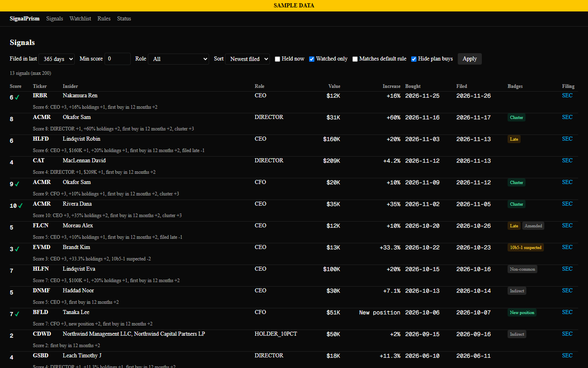
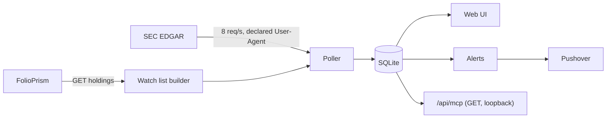
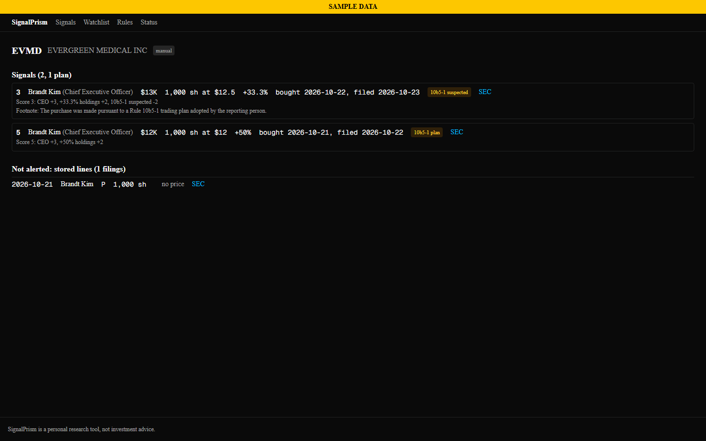
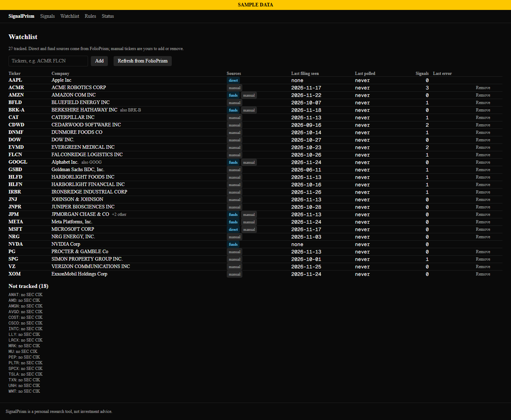
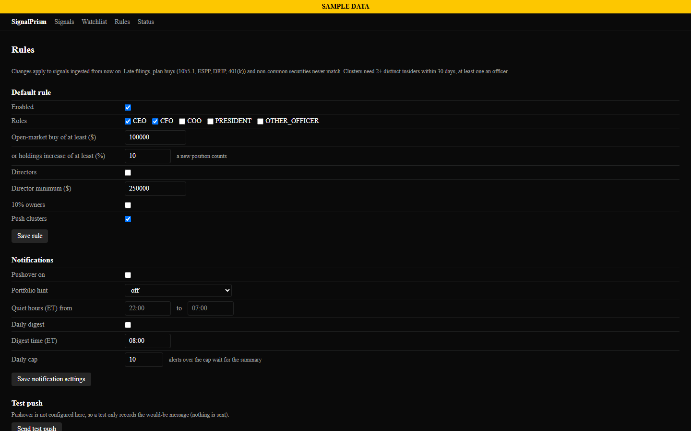
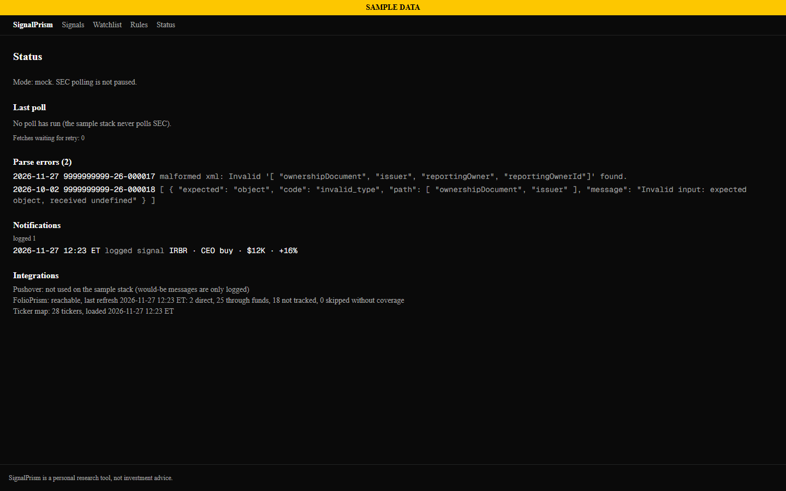

# SignalPrism

Self-hosted SEC Form 4 tracker for a personal watch list. It polls SEC EDGAR for the companies you follow, keeps only open-market purchases (code P), scores them into signals, detects cluster buying and sends Pushover alerts. The default alert rule is a CEO or CFO buy of at least $100K or a 10% holdings increase.

SignalPrism is a personal research tool, not investment advice.



## What it does

- Source is SEC EDGAR only (submissions JSON and Form 4 XML); no third-party sites are scraped.
- Only non-derivative open-market purchases count. Option exercises, grants, conversions and tax withholdings are stored for audit, never alerted.
- One signal per insider per filing, with a deterministic score and its breakdown shown. Clusters are 2+ insiders within 30 days, at least one an officer.
- Plan buys (10b5-1, ESPP, DRIP, 401(k)) are shown with a badge but never alerted or clustered.
- Optional FolioPrism bridge builds the watch list from your holdings and marks held stocks.

**Tech stack:** Next.js 16 (App Router) with React 19 and TypeScript, Tailwind CSS v4 and shadcn/ui, SQLite via better-sqlite3 (plain SQL migrations), fast-xml-parser and zod for Form 4 parsing, Vitest for unit tests and Playwright for e2e. Runs on Node 24 in a Docker container (`node:24-slim`, `docker/Dockerfile`), with an in-process scheduler.

## Architecture



## Screens

| | |
|---|---|
|  |  |
|  |  |

## Run and stop

| | Sample stack (default) | Personal stack (optional) |
|---|---|---|
| Data | Fixtures, `DATA_MODE=mock`; never calls sec.gov or Pushover | Live SEC data, `DATA_MODE=live` |
| Banner | Yellow SAMPLE DATA | None |
| URL | `http://127.0.0.1:8500` | `http://127.0.0.1:<PERSONAL_PORT>` |
| Compose file | `docker/compose.yaml` (project `signalprism-sample`) | `docker/compose.personal.yml` (project `signalprism-personal`) |
| Config | Built into the compose file | `.env.personal` (never committed) |
| Volume | `data/sample` | `data/local` |
| Scripts | `start.sh`, `restart.sh`, `logs.sh`, `stop.sh` | `personal-start.sh`, `personal-logs.sh`, `personal-stop.sh` |

```
./scripts/start.sh     # http://127.0.0.1:8500
./scripts/logs.sh
./scripts/stop.sh
```

## Watch list

Add or remove tickers by hand with the scripts inside the running container (tickers come only from the command line). The first `watch:add` loads the ticker map: from SEC in live mode, from a fixture in mock mode.

```
docker compose -f docker/compose.yaml exec app node scripts/watch-add.ts ACMR FLCN        # sample stack
docker compose --env-file .env.personal -p signalprism-personal -f docker/compose.personal.yml exec app node scripts/watch-add.ts TICKER   # personal stack
```

Use `scripts/watch-remove.ts` the same way. Unknown tickers are reported, not added.

The scheduler polls every 30 minutes on weekdays 06:00-22:30 ET and every 3 hours otherwise, so new tickers wait for the next tick. To poll right away (live mode only; the running scheduler does the poll and the script prints its counts):

```
docker compose --env-file .env.personal -p signalprism-personal -f docker/compose.personal.yml exec app node scripts/poll-now.ts
```

The container logs one line per scheduler event (started, lock claimed or waiting, tick ran or skipped, next tick in ET).

## SEC fair access

Every request carries a declared `SEC_USER_AGENT` (live mode refuses to start without it), all requests share one limiter at 8 requests per second, 429/403/503 answers back off exponentially, and repeated 403s pause polling for an hour and show a banner.

## FolioPrism

Set `FOLIOPRISM_URL` and the watch list is rebuilt from FolioPrism at start, daily, and with the "Refresh from FolioPrism" button on Watchlist: direct stocks plus the top 25 stocks held through funds. Funds are told apart by FolioPrism's own data, never by SEC company numbers. Manual tickers stay. Badges and the "Held now" filter show current holdings, so older signals show today's holdings. Holdings stay in memory; only `in_direct`, `in_funds`, `in_portfolio` and `held_via` are stored.

The host must be `127.0.0.1`, `localhost`, `[::1]`, `host.docker.internal` or listed in `PRISM_NET_HOSTS`, or the app refuses to start. FolioPrism stays bound to `127.0.0.1` on the host. From a container, `host.docker.internal` (mapped with `extra_hosts: host.docker.internal:host-gateway` in both compose files) reaches it; the sample stack uses `http://host.docker.internal:8420`, checked from inside the container. The personal stack sets `FOLIOPRISM_URL` in `.env.personal`.

Fallback if `host.docker.internal` does not reach FolioPrism: put both containers on one external Docker network (`docker network create prism-net`), attach both services to it, and set `FOLIOPRISM_URL=http://<folioprism-container>:<port>` with `PRISM_NET_HOSTS=<folioprism-container>`.

Watchlist add, remove and refresh are POST routes that answer loopback requests only (by `Host` and `Origin`).

## Alerts

A new CEO or CFO buy (default: at least $100K or a 10% holdings increase, not late, not a plan buy), or a cluster that gains an insider, becomes a held notification; the scheduler's lock holder sends it. Alerts never fire for history: a company's first poll and any filing more than 3 days old at ingest are recorded only. Quiet hours (ET) hold everything; the daily cap (default 10) sends the rest in one summary the next morning; an optional daily digest bundles the non-urgent ones. Everything is on the Rules page (edits are loopback-only POST forms), with "Send test push". Status shows Pushover usage from the API's limit headers.

Set `PUSHOVER_APP_TOKEN` and `PUSHOVER_USER_KEY` in `.env.personal` (never committed; they are only read by the client and never logged or stored). Without them, or on the sample stack, nothing is sent: the sample stack logs the would-be messages. `PUSH_PORTFOLIO_HINT` (`off`, `flag`, `detail`) seeds the Rules page setting; default `off`. Delivery is at-least-once: a crash during a request can repeat a push, never lose one.

Pushover note: alerts reveal which stocks you follow to an outside service. Enable Pushover end-to-end encryption.

Housekeeping runs weekly in the scheduler and deletes old poll runs, failed fetches, notifications, audit lines and the stored data of long-inactive companies, never signals (`RETENTION_*` variables change the periods).

## Prism MCP

`GET /api/mcp/signals`, `/clusters`, `/ticker/[symbol]` and `/status` serve read-only JSON, bound to `127.0.0.1` and answering loopback requests only. The only portfolio information returned is the `held_via` flag, never dollar holdings. The matching `signalprism_*` tools live in [prism-mcp](https://github.com/SM4527/prism-mcp); a local model (for example in LM Studio) can answer questions about signals with no data leaving the machine.

## Personal stack (optional)

Live data for your real watch list, on its own port (8510, set by `PERSONAL_PORT`) and its own database in `data/local`. It is started and stopped only by you; the sample stack is what to use for development and demos.

Create `.env.personal` in the repository root (it is never committed):

```
PERSONAL_PORT=<port>
SEC_USER_AGENT="Your Name your@email.example"
FOLIOPRISM_URL=http://host.docker.internal:<port>
PUSHOVER_APP_TOKEN=...
PUSHOVER_USER_KEY=...
```

`SEC_USER_AGENT` is required in live mode. `FOLIOPRISM_URL` is optional and points at your personal FolioPrism (port 8430). Pushover keys are optional; without them nothing is sent.

```
./scripts/personal-start.sh   # http://127.0.0.1:<PERSONAL_PORT>
./scripts/personal-logs.sh
./scripts/personal-stop.sh
```

## Limitations

- Form 4 only; no 13F, no market-wide discovery.
- A 13-month history window.
- Plan buys (10b5-1, ESPP, DRIP, 401(k)) are shown but never alerted.
- "Held now" reflects current holdings, so older signals show today's holdings.
- Foreign private issuers rarely file Form 4, so they rarely show up.
- No price-performance tracking yet.

## Troubleshooting

- **Live mode refuses to start:** `SEC_USER_AGENT` is missing. Set it in `.env.personal` and restart.
- **Polling paused for an hour with a banner:** SEC answered repeated `403`s. Check that `SEC_USER_AGENT` is a real declared contact; polling resumes by itself.
- **FolioPrism not reachable from the container:** `host.docker.internal` is mapped in both compose files. If it still fails, use the `prism-net` fallback described under FolioPrism and list the host in `PRISM_NET_HOSTS`. The app also refuses hosts that are not allowed.
- **Inspecting what happened:** `./scripts/logs.sh` (sample) or `./scripts/personal-logs.sh` (personal) shows one line per scheduler event.

## Development

```
npm install
npm run lint
npm test
npm run e2e
npm run privacy
```

Dockerfile and compose files live in `docker/`.

`npm run privacy` scans for personal data and the personal ports. The pre-push hook in `scripts/hooks/pre-push` runs it on the commits being pushed and refuses a dirty tracked tree. Enable it once per clone:

```
git config core.hooksPath scripts/hooks
```

## Built with Claude Code

Built with [Claude Code](https://claude.com/claude-code).

## License

MIT. See [LICENSE](LICENSE).
